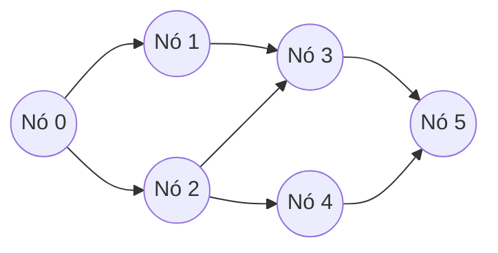
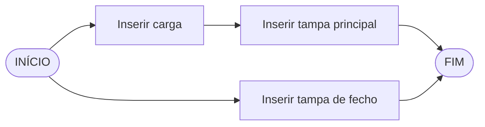

# Resolução Automática de Problemas

**Unidade Curricular:** Planeamento e Tomada de Decisão (PLNTDIA)  
**Mestrado:** Mestrado em Engenharia de Inteligência Artificial (MEIA) — ISEP/IPP  
**Docentes:** Carlos Ramos, Goreti Marreiros (`{csr,mgt}@isep.ipp.pt`)  
**Ano Letivo:** 2025-2026  

---

## 1. Caracterização de um Problema

Um **Problema** pode ser caracterizado como uma questão que nos é colocada de como passar de uma situação num dado mundo para outra situação pretendida, atendendo a um conjunto de regras e restrições que nos são impostas.

- **Mundo do Problema:** O contexto/ambiente onde o problema decorre.
- **Situação (Estado):** Configuração atual do mundo.
- **Situação Pretendida (Objetivo / Meta):** Qual é o estado final que queremos atingir?
- **Alternativas de Resolução:** Que caminhos, ações ou sequências de passos podemos tomar?
- **Restrições e Regras:** Que limitações temos de cumprir durante a transição de estados?

---

## 2. Abordagens à Resolução Automática de Problemas

As duas abordagens principais à Resolução Automática de Problemas e Pesquisa Automática são:
1. **Inteligência Artificial (IA)**
2. **Investigação Operacional (IO)**

### 2.1 Tipos de Soluções Pretendidas
- **Melhor Solução (Ótima):** Garante o custo mínimo ou ganho máximo.
- **Solução Rápida ou em Tempo Útil:** Obtida geralmente através de **heurísticas**, sacrificando a garantia de otimalidade por eficiência temporal.

### 2.2 Desafios Inerentes ao Problema
- **Pode não ter solução:**
  - *Como detetar?*
  - Frequentemente devido a **excesso de restrições** incompatíveis entre si.
- **Pode ter muitas soluções:**
  - *Como escolher a mais conveniente?*
  - Sujeito ao fenómeno da **explosão combinatória**.

### 2.3 Decomponibilidade do Problema
- **Problema Decomponível:** Pode ser partido em subproblemas independentes, resolvidos separadamente e combinados no final.
  $$\int [f(x) \pm g(x)]\,dx = \int f(x)\,dx \pm \int g(x)\,dx$$
- **Problema Não Decomponível:** As decisões afetam-se mutuamente.
  - *Exemplo:* O escalonamento de duas ordens de fabrico ($of_1$ e $of_2$) numa única máquina: não é possível escalonar cada uma isoladamente e simplesmente juntar as soluções, pois disputam o mesmo recurso no tempo.

### 2.4 Natureza dos Passos na Resolução
- **Descartabilidade:** Passos que podem ser ignorados/descartados sem afetar a integridade (ex.: Prova de Teoremas).
- **Reversibilidade:** Possibilidade de desfazer ações e voltar atrás (ex.: Puzzle dos 8).
- **Irreversibilidade:** Ações que não podem ser anuladas (ex.: Xadrez, processos físicos ou químicos).

### 2.5 Solução Única vs. Várias Soluções
- Qual é a melhor solução segundo os critérios estabelecidos?
- A quem cabe a ação sobre o mundo do problema (humano, agente autónomo, múltiplos intervenientes)?

---

## 3. Conceito de Agente Inteligente

> Um **Agente Inteligente** realiza continuamente 3 funções:
> 1. **Perceção** das condições dinâmicas do ambiente;
> 2. **Ações** para afetar as condições do ambiente;
> 3. **Raciocínio** para interpretar o resultado da perceção, resolver problemas, inferir e determinar as ações a realizar *(Hayes-Roth, 1995)*.

- **Sensores:** Termómetro, sensor de posição, sensor de imagem, laser (podem ser *passivos* ou *ativos*).
- **Atuadores:** Braço robótico, máquina CNC, autómato, veículos autónomos.
- **Inteligência:** Inferência, Raciocínio, Planeamento, Otimização, Compreensão, Aprendizagem.
- **Comunicação, Interação e Acesso:** Com outros agentes, humanos, autómatos, bases de dados, serviços web.

```
       ┌────────────────────────────────────────────────────────┐
       │             Comunicação, Interação, Acesso             │
       ├──────────────┬──────────────────────────┬──────────────┤
       │   Sensores   │       Inteligência       │  Atuadores   │
       │   (Perceção) │  (Inferência/Decisão)   │   (Ações)    │
       └───────▲──────┴──────────────────────────┴──────┬───────┘
               │                                        │
               └─────────── Mundo / Ambiente ───────────┘
```

### 3.1 Sistemas Multi-Agente (MAS)
O agente raramente opera isolado. Num **Sistema Multi-Agente**, vários agentes cooperam ou competem na resolução de problemas e/ou na partilha de recursos limitados.

### 3.2 Outras Entidades no Mundo do Problema
No ambiente coexistem:
- Pessoas, operadores e autómatos;
- Serviços externos (Web, Cloud APIs);
- Eventos estocásticos não controlados (avarias, variações climáticas, perturbações).

### 3.3 Tipos de Informação, Mundos e Abordagens

```
             ┌─── Completa e Correta ──► Mundo Estruturado ───► Abordagem Deliberativa
 Informação ─┤
             └─── Incompleta /        ──► Mundo Não        ──► Abordagem Reativa
                  Incorreta / Incerta     Estruturado          (com componentes deliberativas)
```

- **Mundo Estruturado & Abordagem Deliberativa:**
  - *Exemplo:* Garry Kasparov vs. Deep Blue (1997) no Xadrez. Informação completa, regras determinísticas, mundo discreto e estruturado.
- **Mundo Não Estruturado & Abordagem Reativa:**
  - *Exemplo:* Condução de Veículos Autónomos. Informação dinâmica, incompleta, com ruído e incerteza, exigindo reação imediata a imprevistos aliada a planeamento deliberativo de trajetos.

---

## 4. O que é Necessário para Resolver um Problema Automaticamente?

1. **Defini-lo de modo preciso:** Formalizar estados, ações possíveis, regras e metas.
2. **Analisá-lo:** Identificar características (decomponibilidade, determinismo, reversibilidade, complexidade).
3. **Escolher as melhores técnicas a aplicar:** Pesquisa em espaço de estados, meta-heurísticas, programação linear, etc.

---

## 5. O Espaço de Estados

### 5.1 Conceito
- Uma representação para problemas em mundos cujas situações possam ser enumeradas e as transições sejam discretas.
- O **Espaço de Estados** é um grafo direcionado $G = (V, E)$:
  - **Nós ($V$):** Representam *estados* (situações estáveis do mundo, ex.: tabuleiro de xadrez após uma jogada).
  - **Arcos ($E$):** Representam *transições* (ações que mudam o estado).

### 5.2 Discretização de Problemas Contínuos
Problemas contínuos podem frequentemente ser discretizados em estados significativos.
- *Exemplo:* Uma bicicleta a aproximar-se de um cruzamento. Não é relevante a micro-trajetória milimétrica, mas sim a decisão discreta no cruzamento: virar à esquerda, seguir em frente ou virar à direita.

### 5.3 Exemplo: Planos de Montagem Alternativos num Grafo

Considere o seguinte espaço de estados onde o **Nó 0** é o estado inicial e o **Nó 5** o estado final pretendido:



**Planos alternativos de montagem para ir de Nó 0 até Nó 5:**
1. $\text{Nó } 0 \to \text{Nó } 1 \to \text{Nó } 3 \to \text{Nó } 5$
2. $\text{Nó } 0 \to \text{Nó } 2 \to \text{Nó } 3 \to \text{Nó } 5$
3. $\text{Nó } 0 \to \text{Nó } 2 \to \text{Nó } 4 \to \text{Nó } 5$

Existem **3 planos alternativos**.

### 5.4 Características da Exploração do Espaço de Estados
- **Representação Absoluta vs. Relativa:** Guardar a descrição completa do estado ou apenas a diferença face ao estado anterior.
- **Transições Unidirecionais vs. Bidirecionais:** Se as ações são reversíveis diretamente ou apenas seguem uma direção.
- **Travessia vs. Construção:** O grafo já está todo pré-definido em memória ou é gerado dinamicamente à medida que é explorado?
- **Fator de Ramificação ($b$):** Número médio de sucessores de cada nó, determinante na complexidade computacional $O(b^d)$.
- **Direção da Pesquisa:**
  - *Pesquisa Direta (Forward Search):* Do estado inicial para os estados objetivo.
  - *Pesquisa Inversa (Backward Search):* Do objetivo para o estado inicial.
  - *Pesquisa Mista / Bidirecional:* Encontro a meio caminho.

---

## 6. Restrições

Uma **restrição** é um condicionalismo imposto à solução de um problema:
- **Expressas por inequações:** ex. $\text{Custo} \le 25\,000$ €.
- **Enumerativas:** ex. $\text{Marca} \in \{\text{Mercedes-Benz}, \text{BMW}, \text{Volvo}\}$.
- **Efeito no Espaço de Busca:** À medida que se introduzem restrições, o número de soluções válidas diminui, o que é **positivo para atenuar a explosão combinatória**.

### 6.1 Tipos de Restrições
- **Restrições Obrigatórias (*Hard Constraints*):** Têm impreterivelmente de ser satisfeitas (segurança, leis físicas, legislação).
- **Restrições Facultativas (*Soft Constraints*):** Desejáveis, mas podem ser relaxadas ou violadas mediante penalização se não existir outra alternativa viável.

### 6.2 Exemplo Numérico de Restrições
Sejam $X$ e $Y$ inteiros positivos com as restrições:
$$\begin{cases} 2 \le X \le 4 \\ Y \ge 2 \\ X + Y \le 6 \end{cases}$$

Soluções válidas:
- Para $X=2$: $Y \in \{2, 3, 4\} \implies (2,2), (2,3), (2,4)$
- Para $X=3$: $Y \in \{2, 3\} \implies (3,2), (3,3)$
- Para $X=4$: $Y = 2 \implies (4,2)$

Total: **6 soluções**.

---

### 6.3 Questão Prática 1: Escalonamento de Projeto com Restrições

> **Enunciado:**  
> Um projeto envolverá trabalhadores que laboram 8 horas por dia. Deve ficar concluído em 3 dias ou menos e envolve entre 80 e 100 horas de trabalho. Devem estar envolvidos entre 4 e 6 trabalhadores:
> - $4 \le \text{trabalhadores} \le 6$
> - $1 \le \text{dias} \le 3$
> - $80 \le \text{horas} \le 100$
> - $\text{horas} = \text{trabalhadores} \times \text{dias} \times 8$
>
> **Em quais das opções o projeto se consegue realizar?**  
> a) 2 dias com 4 trabalhadores e também 2 dias com 5 trabalhadores  
> b) **[CORRETA]** 2 dias com 5 trabalhadores e também 3 dias com 4 trabalhadores  
> c) 3 dias com 4 trabalhadores e também 3 dias com 5 trabalhadores  
> d) 1 dia com 6 trabalhadores e também 2 dias com 5 trabalhadores  
> e) Nenhuma das anteriores  
>
> **Resolução:**
> - $2 \text{ dias} \times 5 \text{ trab.} \times 8 = 80 \text{ h}$ (está no intervalo $[80, 100]$ e cumpre $1 \le 2 \le 3$ e $4 \le 5 \le 6$) $\to$ **Válido**.
> - $3 \text{ dias} \times 4 \text{ trab.} \times 8 = 96 \text{ h}$ (está no intervalo $[80, 100]$ e cumpre $1 \le 3 \le 3$ e $4 \le 4 \le 6$) $\to$ **Válido**.
> - *(Nota: 3 dias com 5 trabalhadores = 120 h > 100 h; 2 dias com 4 trabalhadores = 64 h < 80 h).*

---

## 7. Grafos de Precedências

Um **grafo de precedências** representa operações como nós e precedências como arcos dirigidos ($A \to B$ significa que $A$ tem de ser concluída antes de $B$ iniciar).



- **Normalização de Grafos Disconexos:** Insere-se um nó virtual **INÍCIO** que precede todas as operações sem antecessores, e um nó virtual **FIM** que sucede a todas as operações sem sucessores.

### 7.1 Complexidade e Contagem de Planos Alternativos

A complexidade em grafos de precedências depende fundamentalmente da **topologia do grafo**:
- **Aumentar o número de nós:** não diminui a complexidade.
- **Aumentar o número de restrições (arcos):** não aumenta a complexidade (reduz ou mantém os planos possíveis).

#### Exemplos de Topologias:
1. **$N$ operações totalmente paralelas (sem restrições):**
   $$\text{Planos} = N!$$
   Para 4 operações paralelas ($A, B, C, D$): $4! = 24$ sequências possíveis.
2. **$N$ operações puramente em série ($N-1$ restrições lineares):**
   $$\text{Planos} = 1$$
   Para 4 operações em série ($A \to B \to C \to D$): apenas $1$ sequência.
3. **1 operação em série seguida de 3 operações paralelas:**
   $A$ tem de vir primeiro, e $B, C, D$ podem ocorrer em qualquer ordem:
   $$1 \times 3! = 6\text{ sequências}.$$

### 7.2 Fórmula de Agregação Série-Paralelo
Quando temos dois ramos paralelos, um composto por uma série de $n$ operações e o outro por uma série de $m$ operações, o número total de intercalações válidas (*interleavings*) é dado por:
$$\sum_{i=1}^{\min(n+1, m)} C_i^{n+1} C_{i-1}^{m-1} = \binom{n+m}{n} = \frac{(n+m)!}{n! \, m!}$$

---

### 7.3 Questões Práticas sobre Grafos de Precedências

> **Questão 2: Efeito de Adicionar um Arco**  
> Num grafo $G$ com $N$ nós e $A$ arcos de precedência, cria-se $G_1$ adicionando mais um arco entre dois nós já existentes mantendo os restantes.  
> **Afirmação verdadeira:**  
> **O número de planos alternativos em $G_1$ só será menor que em $G$ se o arco incluído não for redundante** (se for redundante, o número de planos mantém-se inalterado).

> **Questão 3: Comparação entre Dois Grafos de 4 Operações**  
> Considere:
> - Grafo $G$: 4 operações $\{A, B, C, D\}$ com $\{A \text{ precede } B\}$ e $\{C \text{ precede } D\}$.
> - Grafo $G'$: 4 operações $\{A', B', C', D'\}$ com $\{A' \text{ precede } B'\}$ e $\{B' \text{ precede } C'\}$.
>
> **Qual tem mais planos?**  
> - Em $G$: dois ramos paralelos de 2 operações: $\binom{2+2}{2} = \frac{4!}{2! 2!} = 6$ planos.
> - Em $G'$: cadeia de 3 operações $A' \to B' \to C'$ com $D'$ livre. Há 4 posições possíveis para intercalar $D'$: $1 \times 4 = 4$ planos.  
> **Conclusão:** **Há mais planos alternativos em $G$ (6) do que em $G'$ (4).**

> **Questão 4: 5 Operações com Precedências $a \to b \to c$ e $d \to e$**  
> Ramos paralelos de tamanho $n=3$ ($a,b,c$) e $m=2$ ($d,e$):
> $$\text{Planos} = \binom{3+2}{3} = \binom{5}{3} = \frac{5!}{3! 2!} = 10\text{ planos}$$
> Planos explícitos: `deabc`, `adebc`, `abdec`, `abcde`, `daebc`, `dabec`, `dabce`, `adbec`, `adbce`, `abdce`.

> **Questão 5: 6 Operações com Precedências $a \to b \to c$ e $d \to e \to f$**  
> Ramos paralelos de tamanho $n=3$ e $m=3$:
> $$\text{Planos} = \binom{3+3}{3} = \binom{6}{3} = \frac{6!}{3! 3!} = \frac{720}{36} = 20\text{ planos}$$
> Pela fórmula somatória: $4 \times 1 + 6 \times 2 + 4 \times 1 = 4 + 12 + 4 = 20$ planos.

---

## 8. Critérios de Otimização e Pesos Relativos

A avaliação de uma solução é feita através de uma função objetivo multi-critério:
$$\text{Minimizar } f(t, c, d) = k_t \cdot t + k_c \cdot c + k_d \cdot d$$
onde $t$ é o tempo, $c$ o custo e $d$ a distância.

As constantes ponderadoras ($k_t, k_c, k_d$) desempenham dois papéis fundamentais:
1. **Adimensionalização:** Como tempo (s), custo (€) e distância (m) têm unidades incompatíveis, as constantes devem incluir o inverso das grandezas para tornar a função adimensional.
2. **Ponderação Relativa:** Determinar qual dos critérios tem maior relevância prática para a decisão.

> **Questão Prática: Identificação da Variável de Maior Peso Relativo**  
> Dada a função:
> $$f(a,b,c,d,e) = 0.1a - 0.8b + 12c + 90d + 700e$$
> com as gamas:
> - $a \in [500, 1000] \implies \Delta a = 500 \implies \Delta_f = |0.1 \times 500| = 50$
> - $b \in [50, 100] \implies \Delta b = 50 \implies \Delta_f = |-0.8 \times 50| = 40$
> - $c \in [5, 10] \implies \Delta c = 5 \implies \Delta_f = |12 \times 5| = \mathbf{60}$
> - $d \in [-1, -0.5] \implies \Delta d = 0.5 \implies \Delta_f = |90 \times 0.5| = 45$
> - $e \in [0.05, 0.1] \implies \Delta e = 0.05 \implies \Delta_f = |700 \times 0.05| = 35$
>
> **Resposta:** A variável com maior peso relativo no impacto total da função é a **variável $c$** (variação máxima de 60).

---

## 9. Heurísticas

- **Origem:** Do grego *heuristikein* ("encontrar" ou "descobrir", famosa exclamação *"Eureka!"* de Arquimedes).
- **Conceito:** Regras de senso comum ou boas práticas (*Rules of Thumb*) resultantes da observação empírica de um domínio.
- **Vantagem:** Reduzem drasticamente a necessidade de exploração cega do espaço de estados, atenuando a explosão combinatória.
- **Limitação:** Não garantem que se encontre a melhor solução, nem uma boa solução, nem sequer garantem a obtenção de uma solução.
- **Classificação:**
  - **Pesquisa Informada:** Métodos que usam funções heurísticas para guiar a busca.
  - **Pesquisa Não Informada (Cega):** Métodos que exploram a estrutura do grafo sem qualquer estimativa de proximidade ao objetivo.

### 9.1 Funções Heurísticas
- Estimam o custo ou benefício remanescente até à meta:
  - **Minorantes:** Subestimam custos, distâncias ou tempos (fundamentais para garantir otimalidade em algoritmos como $A^*$).
  - **Majorantes:** Sobre-estimam lucros ou benefícios.
- *Exemplo geométrico:* Distância Euclidiana em linha reta entre as coordenadas $(x_i, y_i)$ e $(x_j, y_j)$:
  $$d = \sqrt{(x_j - x_i)^2 + (y_j - y_i)^2}$$

### 9.2 Exemplo: Problema do Caixeiro Viajante (TSP)
- Visitar $N$ cidades e regressar à de partida percorrendo a menor distância, visitando cada cidade exatamente uma vez.
- Número de circuitos possíveis: $(N-1)!$
  - Para 4 cidades ($A, B, C, D$): $(4-1)! = 3! = 6$ circuitos.
  - Para 11 cidades: $10! = 3\,628\,800$ circuitos (a pesquisa exaustiva torna-se computacionalmente intratável).
- **Heurística do Vizinho Mais Próximo:** A partir da cidade atual, escolher sempre a cidade ainda não visitada mais próxima.
  - *Comportamento:* É rápida, mas **não garante a solução ótima** (pode forçar uma última aresta muito longa no regresso).

### 9.3 Aplicações Análogas ao Caixeiro Viajante (Sequenciamento)
Problemas de sequenciamento de $N$ itens num recurso levam a $N!$ ordenações possíveis:
- Sequenciamento de aterragens de aviões numa pista.
- Escalonamento de cirurgias num bloco operatório hospitalar.
- Escalonamento de ordens de fabrico numa máquina industrial.

### 9.4 Heurísticas Usuais no Planeamento da Produção (*Scheduling*)

| Heurística | Nome Completo | Descrição e Critério |
| :--- | :--- | :--- |
| **FIFO** | *First In First Out* | As tarefas são processadas por estrita ordem de chegada. |
| **Setup** | *Mesma Preparação* | Agrupa e processa consecutivamente tarefas que partilham a mesma configuração/ferramentas de máquina. |
| **EDD** | *Earliest Due Date* | Prioridade às tarefas com prazos de entrega mais próximos (*deadlines* mais apertadas). |
| **SPT** | *Shortest Processing Time* | Tarefas mais curtas são processadas primeiro (minimiza o número médio de tarefas em espera). |
| **PCO** | *Preferred Customer Order* | Atribui prioridade com base na categoria ou importância estratégica do cliente. |
| **MIN.SLACK** | *Minimum Slack Time* | Prioridade à menor folga ($\text{Prazo} - \text{Tempo de Processamento Necessário}$). |
| **CR** | *Critical Ratio* | Razão entre tempo restante e tempo de processamento: $\text{CR} = \frac{\text{Tempo até ao Prazo}}{\text{Tempo de Processamento}}$. Se $\text{CR} < 1$ atrasada; $\text{CR} = 1$ no limite; $\text{CR} > 1$ com folga. |
| **Cliente Estratégico** | *Faturação / Parceria* | Prioridade a clientes responsáveis pela maior faturação ou parcerias chave. |
| **RANDOM** | *Aleatório* | Seleção estocástica da próxima tarefa (usada como *baseline* comparativo). |

---

## 10. Princípios Fundamentais de Pesquisa

Estudam-se 5 princípios básicos de pesquisa:
1. **Gerar e Testar (*Generate and Test*)**
2. **Primeiro em Profundidade (*Depth-First Search* - DFS)**
3. **Primeiro em Largura (*Breadth-First Search* - BFS)**
4. **Primeiro o Melhor (*Best-First Search*)**
5. **Gerar todas as soluções e escolher a melhor (Exaustivo)**

---

### 10.1 Gerar e Testar
- **Tipo:** Não informado.
- **Funcionamento:** Gera um novo estado arbitrário/aleatório a partir do mundo e testa se corresponde ao objetivo. Se sim, termina; se não, repete.
- **Desvantagem:** É praticamente uma busca aleatória, podendo levar tempo proibitivo em espaços extensos.

---

### 10.2 Primeiro em Profundidade (*Depth-First Search* - DFS)
- **Tipo:** Não informado.
- **Funcionamento:** Avança progressivamente ao longo de um ramo até ao nó mais profundo possível.
- **Vantagens:**
  - Baixíssimo consumo de memória ($O(b \cdot d)$, onde $b$ é o fator de ramificação e $d$ a profundidade máxima).
  - Adequado quando existem múltiplas soluções dispersas no espaço.
- **Requisito Crucial:** Deve ser implementado com **Retrocesso (*Backtracking*)** e controlo de estados repetidos/ciclos, para recuar ao encontrar um "beco sem saída".
- **Desvantagem:** Pode perder-se em ramos infinitos ou encontrar soluções de custo muito elevado antes de explorar ramos com soluções melhores.

#### Exemplo Prático: Autoestradas da Austrália (Objetivo: Brisbane $\to$ Darwin)
Critério de desempate: ordem alfabética; evitar ciclos.
1. `Brisbane (0)`
2. Expande `Cairns` (alfabética face a Melbourne, Sydney, Tennant Creek). Custo: 1682.
   - De `Cairns` não há novas ligações diretas a cidades não visitadas $\implies$ **Beco sem saída $\to$ Retrocede**.
3. Expande `Melbourne (1776)`.
   - De `Melbourne`, conexões a `Adelaide (2503)` e `Canberra (2503)`. Ordem alfabética escolhe `Adelaide (2503)`.
   - De `Adelaide`, conexões a `Canberra (3662)` e `Perth (5198)`. Ordem alfabética escolhe `Canberra (3662)`.
   - De `Canberra`, conexão a `Sydney (3948)`. De `Sydney`, não há novos caminhos sem ciclo $\implies$ **Beco sem saída $\to$ Retrocede**.
   - Volta a `Adelaide` e escolhe `Perth (5198)`.
   - De `Perth`, conexão direta a `Darwin (9046)`.
   - **Solução encontrada:** Brisbane $\to$ Melbourne $\to$ Adelaide $\to$ Perth $\to$ Darwin com custo acumulado **9046 km**.
   - *Nota:* Encontrou solução, mas está muito longe da solução ótima (que seria via Tennant Creek com 3476 km).

---

### 10.3 Primeiro em Largura (*Breadth-First Search* - BFS)
- **Tipo:** Não informado.
- **Funcionamento:** Explora a árvore nível a nível (transversalmente). Só avança para o nível $N+1$ depois de todos os nós do nível $N$ terem sido expandidos.
- **Vantagens:**
  - **Garante encontrar a solução com o menor número de passos (nível mais raso da árvore).**
  - Completo se o fator de ramificação for finito.
- **Desvantagens:**
  - Não garante a solução de menor custo se as arestas tiverem pesos desiguais.
  - Consumo exponencial de memória ($O(b^d)$), inviável para árvores profundas.

#### Exemplo Prático: Autoestradas da Austrália (Brisbane $\to$ Darwin)
- **Nível 0:** `Brisbane (0)`
- **Nível 1:**
  - `Cairns (1682)`
  - `Melbourne (1776)`
  - `Sydney (917)`
  - `Tennant Creek (2487)`
- **Nível 2:**
  - A partir de `Melbourne`: `Adelaide (2503)`, `Canberra (2503)`
  - A partir de `Sydney`: `Canberra (1203)`, `Adelaide (2076)`
  - A partir de `Tennant Creek`: `Adelaide (4529)`, **`Darwin (3476)`** $\implies$ **Solução encontrada no Nível 2!**
- **Caminho:** Brisbane $\to$ Tennant Creek $\to$ Darwin com **3476 km**.

---

### 10.4 Primeiro o Melhor (*Best-First Search* - Guloso)
- **Tipo:** Informado.
- **Funcionamento:** Semelhante ao DFS com retrocesso, mas em vez de desempatar cegamente (ex. por ordem alfabética), avalia os nós sucessores com base numa **função heurística local** (escolhe o nó que parece estar mais próximo da meta).
- **Requisito:** Necessita de uma estimativa numérica (ex.: distância euclidiana ao destino). Deve suportar retrocesso perante becos sem saída.

#### Exemplo Prático: Brisbane $\to$ Perth (usando distâncias estimadas em linha reta até Perth)
Estimativas a Perth: Cairns: 3441, Melbourne: 2721, Sydney: 3291, Tennant Creek: 2283, Adelaide: 2131, Darwin: 2653.
1. `Brisbane` expande para: Cairns(3441), Melbourne(2721), Sydney(3291), Tennant Creek(2283).
2. O mais promissor é `Tennant Creek (2283)`.
3. De `Tennant Creek`, vizinhos são `Adelaide (estimativa 2131)` e `Darwin (estimativa 2653)`. Escolhe `Adelaide`.
4. De `Adelaide`, vizinho direto `Perth (0)` $\implies$ Solução atingida: Brisbane $\to$ Tennant Creek $\to$ Adelaide $\to$ Perth com custo $2487 + 2042 + 2695 = 7224\text{ km}$.

---

### 10.5 Gerar Todas as Soluções e Escolher a Melhor (Busca Exaustiva)
- **Princípio:** Continua a expandir o espaço até que todas as soluções possíveis tenham sido identificadas, ou até ser matematicamente impossível existirem soluções melhores nos ramos restantes.
- **Vantagem:** Garante a obtenção do ótimo global absoluto.
- **Desvantagem:** Com a subida da dimensão do problema, a explosão combinatória torna a geração exaustiva impraticável em tempo útil.

